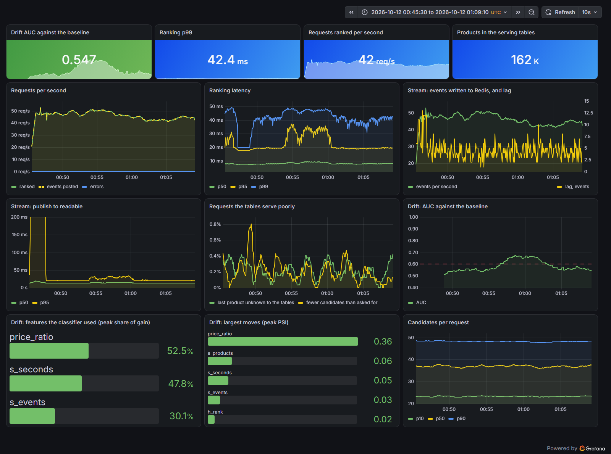

# marketplace-recs

[](https://github.com/mateus-aleixo/marketplace-recs/actions/workflows/ci.yml)


Next-product recommendations for an online store, built on 42 million real events from
one month of a large multi-category shop. Given the products a visitor has looked at so
far in a session, the system predicts which product they will look at next. It uses
co-visitation candidates and a LightGBM ranker, and it is evaluated on 200,000 sessions
from a week that no model was trained on.

The project also includes:

- an HTTP API that ranks a session in 2.6 ms per request on one vCPU;
- an event stream (Redpanda and Redis), so a visitor's latest click reaches their
  recommendations 12 ms after it happens;
- a nightly job (Airflow) that rebuilds the tables the ranker reads;
- the same tables built as SQL in BigQuery, identical row for row to the local build;
- deployment on Google Cloud with Terraform: the API is live on Cloud Run, and it was
  load-tested on GKE Autopilot with one to four pods;
- an offline replay of the test week as an A/B test, with a power analysis, CUPED and
  interleaving;
- monitoring: Prometheus metrics, a Grafana dashboard and a drift check on the live
  features.

## Live API

```
https://recs-api-s3kndyc7za-ew.a.run.app
```

`POST /recommend` takes a session's events, oldest first, and returns the products most
likely to come next. `GET /docs` lists every route. The service scales to zero, so the
first request after a quiet period waits about 6 seconds while an instance starts. The
per-session routes also work, but each instance keeps its own sessions, because the free
demo does not pay for Redis.

```bash
curl -s https://recs-api-s3kndyc7za-ew.a.run.app/recommend \
  -H 'Content-Type: application/json' \
  -d '{"events": [{"product_id": 1004767}, {"product_id": 1004833}], "k": 5}'
```

The example sends two Samsung phones and gets back five Samsung phones. The first phone
the visitor looked at comes first, because visitors often go back to a product they saw
earlier in the session.

## Results

The test set is 200,000 sessions from the last week of October 2019. Each session is cut
at a random point, and the target is the next product the visitor looked at. Every model
is built only from the weeks before.

| model | recall@20 | NDCG@10 | MRR@20 |
|---|---:|---:|---:|
| the most popular products of the last 7 days | 0.085 | 0.027 | 0.021 |
| the session's own products, most recent first | 0.164 | 0.099 | 0.091 |
| item to item: co-visitation of the last product | 0.442 | 0.191 | 0.155 |
| co-visitation of the whole session | 0.444 | 0.186 | 0.149 |
| LightGBM ranker over the candidates | 0.495 | 0.239 | 0.199 |

Serving latency from a container limited to one vCPU with one worker, which is how it runs
on Cloud Run and GKE, using real test sessions as requests:

| concurrent clients | requests per second | p50 | p95 | p99 |
|---:|---:|---:|---:|---:|
| 1 | 337 | 2.6 ms | 4.2 ms | 5.1 ms |
| 4 | 477 | 6.8 ms | 14.3 ms | 16.8 ms |
| 16 | 483 | 31 ms | 58 ms | 68 ms |
| 64 | 481 | 128 ms | 151 ms | 259 ms |

Events through Redpanda (which speaks the Kafka API) into Redis, which every API worker
reads:

| measure | result |
|---|---|
| one consumer working through a backlog | 35,800 events per second (the store's busiest minute had 34 per second) |
| publish to readable, at 2,480 events per second | 20 ms p50, 29 ms p95 |
| an event posted to the API, to a recommendation that uses it | 12 ms p50, 21 ms p95, none of 200 sessions missed |

The same test week with the tables rebuilt every night instead of frozen at the start of
the week, with the same ranker:

| tables | recall@20 | NDCG@10 | recall@20 on the last day |
|---|---:|---:|---:|
| frozen for the week | 0.495 | 0.239 | 0.483 |
| rebuilt nightly | 0.512 | 0.246 | 0.515 |

On Google Cloud ([infra/](infra/README.md)), the nightly tables built as SQL in BigQuery,
compared with the polars build of the same night:

| night | rows compared | identical | same top 20 from the API | BigQuery |
|---|---:|---:|---:|---:|
| 23 October | 5,852,752 | all | 5,000 of 5,000 sessions | 19 s, 3.3 GB scanned |
| 27 October | 6,087,817 | all | 5,000 of 5,000 sessions | 19 s, 3.9 GB scanned |

The API on GKE Autopilot, one vCPU per pod, loaded by k6 from inside the cluster with a new
connection for each request, and what Autopilot bills for the pods:

| pods | requests per second | p50 | p95 | p99 | € per million requests |
|---|---:|---:|---:|---:|---:|
| 1 | 100 | 6.1 ms | 8.4 ms | 10.5 ms | 0.13 |
| 1 | 150 | 6.5 ms | 181 ms | 505 ms | 0.09 |
| 4 | 400 | 12 ms | 50 ms | 130 ms | 0.13 |
| 3, chosen by the autoscaler | 300 | 8.6 ms | 44 ms | 134 ms | 0.13 |
| 4, chosen by the autoscaler | 400 | 12 ms | 124 ms | 338 ms | 0.13 |

The same image on Cloud Run, called from the same region, with at most two instances:

| requests per second | p50 | p95 | p99 | instances | € per million requests |
|---:|---:|---:|---:|---:|---:|
| 50 | 11.7 ms | 15.6 ms | 19.6 ms | 1 | 0.75 |
| 100 | 11.2 ms | 21.7 ms | 37.4 ms | 2 | 0.68 |
| 150 | 14.9 ms | 53.6 ms | 64.0 ms | 2 | 0.65 |

The whole test week replayed as an online experiment: 1,126,667 sessions from 653,559
visitors, each scored with both lists. Smaller effects come from treatments that show the
ranker's list in only some of the sessions. The table gives the days until each test has
80% power at a 5% significance level (two-sided), and how many times more visitors the
A/B test needs than interleaving:

| ranker's list shown in | true lift in recall@20 | A/B test | interleaving | visitors, A/B test over interleaving |
|---|---:|---:|---:|---:|
| every session | 5.3 points | 1 day | 1 day | 8.7 |
| half of the sessions | 2.7 points | 1 day | 1 day | 9.3 |
| a fifth | 1.1 points | 1 day | 1 day | 9.2 |
| a tenth | 0.51 points | 3 days | 1 day | 9.8 |
| a twentieth | 0.27 points | more than the 8 days (74% power at the end) | 1 day | 8.8 |

The drift check against faults planted in one day of real requests, each in a share of
the sessions. The number is the AUC of a classifier that tries to tell the day from the
day before (0.5 means no difference). Clean, the day reads 0.508.

| planted fault | in every session | in a quarter | in a tenth | feature the check names |
|---|---:|---:|---:|---|
| prices sent in cents | 0.999 | 0.628 | 0.569 | price_ratio |
| timestamps sent in milliseconds | 0.986 | 0.618 | 0.544 | s_seconds |
| brand missing | 0.945 | 0.616 | 0.549 | same_brand |
| category missing | 1.000 | 0.627 | 0.565 | same_category |
| every event sent as a view | 0.529 | 0.513 | 0.513 | none |

The dashboard below is from a 24-minute replay of 28 October through the API, 2.5 times
faster than real time, with a broken client sending prices in cents for a quarter of the
sessions between minutes 10 and 16. The drift AUC reads 0.54 to 0.56 before the fault,
crosses the alert threshold of 0.6 within 87 seconds of the fault starting, stays at 0.65 to
0.67 with `price_ratio` as the top feature, and falls back under 0.6 two minutes after the
fault ends.



## Findings

### 1. The ranker improves NDCG@10 by a quarter, and the candidates set its ceiling

Ranking the candidates with LightGBM (LambdaRank) raises NDCG@10 from 0.191 to 0.239 and
recall@20 from 0.442 to 0.495 compared with the item-to-item baseline. The candidates
contain the target in 53.9% of sessions, so the ranker already places 92% of the targets
it can reach in its top 20. Further gains have to come from better candidates.

Cold start explains little of the gap. Only 1.3% of targets are products never seen
before the test week, and only 1.2% of last products have no co-visitation neighbours.
Most missed targets are products with history that are not among the 40 strongest
neighbours of anything in the session.

### 2. Most of the signal is in the last product

Co-visitation from the last product alone scores about the same as co-visitation from the
whole session: 0.442 and 0.444 recall@20. The ranker's feature importances agree. Its two
strongest features by gain are the last product's time-weighted co-visitation score (21%)
and how recently a candidate was viewed in the session (18%). Visitors tend to move back
and forth between a few products, which is also why the session's own products, most
recent first, score almost twice as well as popularity.

### 3. Serving computes the same features as training

The offline features come from batch joins over 200,000 sessions at once, while a request
has one session and a budget of about 2 ms. So serving has its own feature code over
compact arrays. A difference between the two would not raise an error; the model would
just rank worse in production than offline. On 5,000 real test sessions, the two paths
give the same candidate set every time, every feature within 1.1e-7 relative difference
(float32 rounding), missing values in the same places, and the same top 20 in all 5,000
sessions. CI runs the same check on a synthetic store, with a trained ranker, through the
HTTP API.

### 4. The first load test was measuring TCP delays

The model ranks a session in 1.25 ms in process, but the first load test measured 47 ms
per request and 21 requests per second from one client. Inside the container, a new
connection per request took 3.4 ms and a kept-alive connection took 44 ms. A constant
delay on reused connections matches the 40 ms delayed-ACK stall. It happened with both of
uvicorn's HTTP parsers on asyncio and disappeared with uvloop, at 2.1 ms. With uvloop, and
with the route later moved onto the event loop (finding 8), one client gets 337 requests
per second at 2.6 ms p50 through Docker's port forwarding, and one vCPU saturates at about
480 requests per second.

### 5. An event reaches its recommendations in 12 ms

With two workers, an event posted to one worker was invisible to the other. Session state
therefore moved to Redis, written by a consumer that reads every event from Redpanda in
order for each session. The first measurement put events 367 ms behind at the median. The
consumer asked for batches of 2,000 with a 0.5 s wait, and at 2,480 events per second a
batch rarely fills, so most events waited the full 0.5 s. A 50 ms wait gave 45 ms. A 10 ms
wait gave 49 ms, because librdkafka leaves Nagle's algorithm on by default, which then set
the floor. With both changed, an event is readable 20 ms after it is published at the
median, and a backlog still drains at 35,800 events per second, since full batches never
wait.

A restarted consumer also left 7 sessions out of 200 more than 5 seconds stale. The old
process died on SIGTERM without leaving its consumer group, and the new one waited for the
group's session timeout. With a clean exit, events flow again within half a second of a
restart.

Through the API, inside the compose network, posting an event takes 0.67 ms and the event
is in a recommendation 12 ms later. From Windows, through Docker Desktop's port
forwarding, every POST took 44 ms regardless of the client, so the published numbers were
measured inside the network.

### 6. Week-old tables cost 3 points of recall@20, and a nightly rebuild wins them back

All the results above score the test week with tables built before it starts, so by the
last day the tables are a week old. Scoring the same 200,000 cases day by day, with the
co-visitation matrices, product counts and popularity rebuilt each night from all earlier
events and the ranker unchanged, raises recall@20 from 0.495 to 0.512. The gap grows with
the age of the frozen tables: 0.7 points on the second day, 2.1 on the fifth and 3.1 on
the last.

The nightly job is an Airflow DAG over four plain functions. It checks that the day's
events are complete and between half and twice the median of the previous week. It builds
a new version. It lets the version through only if it loads, its catalogue changed by
less than 25%, its neighbour lists overlap those of the serving version, and it ranks a
fixed set of sessions cleanly. Then it switches a pointer that the API reads on every
request. On real data a night takes about 2 minutes: 1,435,327 events for 25 October, 1.01
times the median of the previous week, 159,663 products and an overlap of 0.95. When 26
October was published while recommendations were being requested, the API moved to the
new tables without a restart and without a failed request.

### 7. BigQuery builds the same tables, once its sums are made order-independent

The nightly statistics also run as SQL in BigQuery ([`sql/`](src/marketplace_recs/sql)).
One self-join over each session's 30 most recent events builds all three co-visitation
matrices, and window functions build the product statistics. Only the finished tables
come back, so the export, the gates and the API run unchanged.

The first comparison with the polars build matched the type and buy-to-buy matrices row
for row, but 31 of the time matrix's 2.8 million rows differed. Each one was a tie: two
neighbours whose weights agreed to 16 significant digits, competing for the last place in
a product's top 20. Floating-point sums depend on the order of their terms, and BigQuery
adds them in a different order from one run to the next, so the same night built twice
gave two different tables. The time weight is linear in the event's time, so the SQL now
sums integer seconds and divides once per pair. On both nights compared, every neighbour
row, every product statistic and every exported serving array is identical to the polars
build, a rebuild writes the same rows, and the ranker scores the same 0.4951 recall@20 on
the test week with either.

CI cannot reach BigQuery, so it transpiles the SQL to DuckDB with sqlglot and runs it on
the synthetic store against the polars build. Thirteen deliberate changes to the SQL each
make that test fail: the 30-event cut, each event weight, both time limits, the cart
filter, the time weight, the tie-break, the one-day and seven-day windows, and the
latest-price rule. Three of them passed the test until the synthetic store was given
purchases, events on the last day of the night, and a price that changes twice within a
second.

A night takes 19 s of BigQuery and scans 3.9 GB, well inside the free tier's terabyte per
month, while polars takes 169 s on a laptop. Including reading the tables back, exporting,
checking and publishing, a BigQuery night runs in 40 s.

### 8. On GKE, a health check and the thread pool each caused tail latency

The first ramp on GKE Autopilot broke down at 200 requests per second and never recovered.
Up to 1,600 requests per second were offered, but the pods served at most 700, at about 3
s p50. Kubernetes checked readiness on `/health`, which FastAPI runs in its thread pool. On
a saturated pod, the probe waited behind the requests being ranked, missed its 1 s
timeout, and the pod was taken out of the service. Its kept-alive connections kept sending
it requests, so it stayed saturated, while new connections piled onto the next pod, which
then failed the same way. Of the 7 pods the autoscaler started, between none and five were
in the service at any time, usually two. On an overloaded one-vCPU container, `/health`
took 1.3 to 1.6 s, and a coroutine route, `/ready`, took 32 to 64 ms.

With the probe on `/ready`, one pod still answered 60 to 150 requests per second at 6 ms
p50 but 0.2 to 1.3 s p99. The kernel had throttled it in 1,329 of 4,132 scheduling
periods. LightGBM releases Python's GIL while it predicts, so a second thread from the pool
ran at the same time. A pod limited to one vCPU then used up its CPU quota in the first
half of each 100 ms period and stalled for the rest. Ranking on the event loop instead,
one request at a time, the pod was throttled in 6 of 4,344 periods, p99 fell to 9 to 12 ms
at the same rates, and a request cost 4.9 ms of CPU instead of 5.6. Letting the thread
pool burst to a second vCPU also fixed the latency, at 6.3 ms of CPU per request, but only
while the node had a spare core.

The event loop has its own cost. With two workers in one container, kept-alive
connections stay with the worker that accepted them, so a busy worker cannot use the
other core, and 16 clients got 295 requests per second where the thread pool had served
656. So the API runs one worker per vCPU and scales by adding pods or instances.

That brought back the first failure in another form. A saturated event loop answers
`/ready` only after the requests already queued, and from 800 requests per second pods
were taken out of the service again. Readiness is now a TCP check. uvicorn only starts
listening once the model is loaded, and the kernel completes the TCP handshake even while
the event loop is busy, so a saturated pod stays in the service and the autoscaler adds
pods instead.

### 9. One pod serves 100 requests per second at 10 ms p99, and the free trial limits the cluster to four

With a new connection per request, as from many separate visitors, one pod answered 100
requests per second at 6.1 ms p50 and 10.5 ms p99, and saturated near 190. On kept-alive
connections the same pod had held 150 requests per second at 12 ms p99, but here 150
raised p99 to 505 ms, because accepting a connection for every request also costs CPU.
Four pods took 400 requests per second at 130 ms p99 and saturated near 560, or 140 per pod
against 190 for a pod on its own, with two nodes shared between the pods and k6. With pods
held at 70% of their vCPU, the autoscaler followed a ramp from one pod to four. Its one bad
minute was the first doubling, from 100 to 200 requests per second. CPU is averaged over a
window, so the second pod was requested 30 s later and was ready 5 s after that. Requests
that queued on the first pod in the meantime waited up to 8 s, and 3.7% of them went past
k6's 10 s limit. Billed on what the pods request, a million requests cost €0.13 at 100
requests per second per pod.

The free trial sets the ceiling. A trial project gets 12 vCPUs and 250 GB of SSD and
cannot ask for more, and every Autopilot node boots from 100 GB of SSD, so the cluster can
hold two nodes. Autopilot built one with 8 vCPUs and one with 2, and its request for a
third failed on quota. Four API pods fit next to k6's three vCPUs, so the measurements stop
near 580 requests per second. Beyond that, the per-pod numbers are the ones that would
scale.

### 10. Cloud Run costs five times as much per request, and nothing when idle

On Cloud Run the same image answered 50 to 150 requests per second at 11 to 15 ms p50 from
the same region. That is a few milliseconds more than inside the cluster, most likely the
trip through Google's front end. Cloud Run bills an instance while it is handling a
request, and at these rates two instances were billed for most of every minute: 90
instance-seconds per minute at 100 requests per second. That comes to €0.65 to €0.75 per
million requests, against €0.13 on GKE. GKE bills a pod whether or not it serves traffic,
though: €35 a month for one, which would pay for 51 million requests on Cloud Run, or 20
per second on average. Below that, and for a public demo that mostly waits for visitors,
Cloud Run is cheaper. Above it, pods are.

Scaling to zero has its own cost. An idle instance shut down about a quarter of an hour
after the last request, and the next request waited 6.4 s for a new one to start. Cloud
Run measured the start at 5.1 to 6.1 s, while the same container is ready in 1.9 s on a
laptop.

### 11. Interleaving needs about a ninth of the visitors an A/B test needs, and CUPED barely helps

Every comparison above shows both models the same sessions. An online test shows each
visitor one of them, and it has to be planned: for how many visitors and how many days.
`replay.py` replays the whole test week as that test would have seen it. Each of the
1,126,667 sessions that touch two products, from 653,559 visitors, gets item to item's top
20 and the ranker's top 20, so its outcome under either list is known and a simulated test
can be checked against the true effect. On the 200,000 cases sampled for the Results
table, the two lists score exactly the published 0.4418 and 0.4951.

Splitting visitors by a salted hash of their id, an A/B test of the ranker measures a lift
of 5.4 points of recall@20 after the first day (95% interval 4.8 to 5.9, from 111,902
visitors), and the same after the week (5.2 to 5.6). An effect that large needs no
planning, but smaller ones do. Diluted treatments show the ranker's list in half, a fifth,
a tenth or a twentieth of the sessions, for true lifts of 2.7, 1.1, 0.51 and 0.27 points.
The power computed from the baseline's variance alone, which is all that is known before a
test, agrees within 4 points everywhere with the share of significant results over 1,000
bootstrap replicates that resample visitors and assign them again. An A/B test detects a
lift of one point within a day and half a point within three days. A quarter of a point
would need 760,000 visitors followed for a week, more than the week had, and after the
week the test has 74% power.

Team-draft interleaving shows every visitor one merged list and credits each click to the
list that contributed the product. The ranker's list wins 29.3% of sessions and the
baseline's 19.2%, and the merged list itself has a recall@20 of 0.485. For the same power,
interleaving needs 8.7 to 9.8 times fewer visitors than the A/B test, so it reaches 80%
power within the first day at every dilution, including the quarter point. On the same
replicates, A/A tests reject 4.2 to 5.3% of the time on each day with the delta-method
variance, and 4.9 to 6.4% for interleaving, which is within the noise of 1,000 replicates.

CUPED found almost nothing to remove. The visitor's item-to-item hits and activity before
the week explain 1.25% of the variance per visitor, so the test needs 1.25% fewer
visitors. Whether the next product is in the list depends mostly on the session and very
little on the visitor: 38% of the week's visitors had no history before it, and a
visitor's sessions are only weakly correlated. The same fact keeps the naive variance close
to the right one. Although 62% of sessions come from visitors with more than one, treating
every session as independent understates the standard error by only 8%, and its A/A tests
reject 5.6 to 6.9% of the time.

### 12. Drift monitoring: the training week is the wrong reference

The drift check uses adversarial validation. A LightGBM classifier tries to tell a sample
of recent requests from a reference sample, using the 24 features the ranker sees, and its
out-of-fold AUC measures how different the two are. An AUC of 0.5 means it cannot tell
them apart, and its feature importances show what changed. The rows of one request share
the session's features, so cross-validation keeps each request in a single fold.

The usual reference is the training data, and on this data it does not work. Every day of
the test week scores between 0.76 and 0.78 against the training week, yet the ranker
performs as well on those days as in the offline evaluation. The classifier relies on the
product popularity features, which count events over the last day and the last 7 days
before each table build. The test week's tables were built a week later than the training
week's, so those counts sit on a different scale. No single feature moves much on its own:
the largest population stability index (PSI) of any feature on any day is 0.013, well
below the 0.1 usually treated as a small shift.

So the live check compares recent traffic with the traffic the serving version saw first.
After a version is published, the first 1,500 sampled requests become its baseline, and
each later window of 1,500 requests is compared with that baseline. Requests are sampled as
a product page sends them, one after every event, and the evaluation samples them the same
way from the recorded month.

The alert threshold is an AUC of 0.6. Clean windows of 1,500 requests, sampled at random
from two days of the test week, never went above 0.518 in 20 tries. Consecutive windows of
live traffic read higher, up to 0.56 in the replay below, because sessions change a little
within an hour and 1,500 requests are enough to notice it. The threshold sits above that.
With a fault in a quarter of the sessions, 78 of 80 windows (20 for each of the first four
faults in the table above) crossed it. With a fault in a tenth of the sessions, none did:
those read 0.52 to 0.57. The check cannot see the fault that sends every event as a view,
because about 96% of events are views anyway.

The check also misses slow staleness. Against the first day of the week, later days score
between 0.505 and 0.523, while frozen tables lose 3 points of recall@20 over the same week
(finding 6). The dashboard tracks this more directly: the share of requests whose last
product is missing from the tables rises from 0.3% on the first day of the week to 2.7% on
the last.

In the replay shown under Results, the check raised an alert 87 seconds after the broken
client started and named `price_ratio`. That is roughly the time it takes for faulty
requests to make up a large share of the 1,500-request window. It stopped alerting 116
seconds after the fault ended. The first version of the replay raised alerts on clean
traffic, with an AUC of 0.66. Sessions that had started before the replay arrived with
truncated histories, so the baseline, taken in the first minutes, looked unlike everything
after it. A product page sends the whole session, so the replay now starts each session
with its earlier events, and the clean readings came down to the 0.54 to 0.56 seen above.

## Data

REES46's [eCommerce behavior data from multi category
store](https://www.kaggle.com/mkechinov/ecommerce-behavior-data-from-multi-category-store),
collected by [REES46](https://rees46.com): every product view, cart addition and purchase
on the store. October 2019 has 42,448,764 events (40.8 million views, 926,516 carts and
742,849 purchases) from 3.0 million users in 9.2 million sessions, over 166,794 products.
The terms ask for the source to be named, as above. `python -m marketplace_recs.data`
downloads the month from REES46 and writes it as typed Parquet. None of the data is
committed.

## Evaluation design

- **Three windows**, so no model is trained on the period it is scored on. Window A, 1 to
  17 October, builds the statistics for the ranker's training sessions. Window B, 17 to 24
  October, supplies those sessions. Window C, 24 to 31 October, is the test, scored with
  statistics from A and B.
- **One case per session.** Each session is cut once at a seeded random point. The target
  is the first product after the cut that differs from the last product before it, so
  reloading a page does not count as a prediction. Only sessions that touch at least two
  products can be cut, and about half of all sessions touch only one.
- **Recall@20, NDCG@10 and MRR@20** over all 200,000 cases. A case whose target never
  appears in the list counts as a miss, so no case is left out.
- **Deterministic.** Ties between events in the same second, and between candidates with
  equal scores, are broken by event order and product id, so a rerun reproduces every
  number here.

## How it works

- **Co-visitation.** Three matrices count the products that sessions touch together:
  within 24 hours, weighted towards the end of the period; within 24 hours, weighted by
  what happened to the second product (view 1, cart 6, purchase 3); and carts and
  purchases within 14 days. A session counts a pair once and contributes only its 30 most
  recent events, so a bot cannot dominate the counts. Each product keeps its 20 strongest
  neighbours.
- **Candidates.** The session's own products and the 40 best co-visitation neighbours of
  its history, 33.6 per session on average.
- **Ranker.** 24 features: the six co-visitation scores (summed over the history and from
  the last product alone) and their total; the candidate's place in the session (whether
  it is there, how recently, how often, and its strongest event); its popularity over 1
  and 7 days; its price, category and brand compared with the last product's; and the
  session's length, age and last event type. LambdaRank with 720 trees, chosen by early
  stopping on held-out training sessions.
- **Serving.** FastAPI over the exported arrays (59 MB) and the LightGBM model, with a
  stateless `POST /recommend`, per-session `POST /sessions/{id}/events` and
  `GET /sessions/{id}/recommendations`, and Prometheus metrics at `/metrics`. The model
  loads before the server starts listening. `/recommend` ranks on the event loop, one
  request at a time, so the API runs one worker per vCPU (finding 8). The image contains
  no polars or pyarrow. CI builds it without a model and checks that it answers 503
  instead of failing to start.
- **Event stream.** `POST /sessions/{id}/events` publishes to Redpanda, keyed by session so
  that a session's events stay in order on one partition. A consumer writes them to Redis
  in batches (`stream.py`), and the API's workers read the shared state.
  `docker-compose.yml` runs the four services, and CI starts them and checks that events
  arrive.
- **Nightly job.** `dags/nightly_tables.py` (Airflow 3.3) runs the check, build, validate
  and publish steps in `pipeline.py` once a day. Versions are written to `model/versions/`
  and only become visible when complete. `model/CURRENT` names the version being served,
  and the API switches on its next request. Airflow 3 treats a bare `@daily` as a trigger,
  so the DAG declares a data-interval timetable and each run covers the day that has just
  ended. CI installs Airflow 3.3.2, parses the DAG and runs it once with the steps
  stubbed. With `RECS_WAREHOUSE=bigquery`, the check and build steps run as SQL in
  BigQuery (`warehouse.py`).
- **Google Cloud.** Two Terraform stacks ([infra/](infra/README.md)). `core` holds the
  project, a budget that sends an email at €5 and €10 of spend, the image registry,
  BigQuery and the Cloud Run service. `gke` holds an Autopilot cluster with the API's
  deployment, service and CPU autoscaler, created for a load test and destroyed after it.
  Cloud Run and GKE run the same image, pinned by digest. k6 runs as a Job inside the
  cluster (`cluster.py`), so a test measures the service and not the internet, and the
  cluster's state is recorded every 5 s during the test. CI checks that both stacks are
  formatted and valid.
- **Offline experiment.** `replay.py` builds both lists for every session of the test
  week, caches them, and passes per-visitor sums to `abtest.py`. Recall@20 is a ratio over
  visitors with a delta-method variance (Deng, Knoblich and Lu, 2018). Power comes from the
  baseline's variance and from 1,000 Poisson bootstrap replicates, each a fresh 50/50
  assignment of resampled visitors, computed as matrix products. CUPED works on the ratio
  linearised per visitor (Deng, Xu, Kohavi and Walker, 2013), with covariates from before
  the week only. Team-draft interleaving (Radlinski, Kurup and Joachims, 2008) is
  vectorised across sessions and checked against a one-session version. A rerun writes the
  same numbers.
- **Monitoring.** With `docker compose --profile monitoring`, Prometheus scrapes the API,
  the stream consumer and the drift check every 5 s, and Grafana shows a dashboard that is
  provisioned from `monitoring/` and versioned with the code. The API exports request
  counts, latency, candidates per request, the share of requests whose last product is
  missing from the tables, and the size of the serving catalogue. Its two workers are
  separate processes, so they write their metrics to a shared directory and `/metrics`
  sums them (prometheus_client's multiprocess mode). Without it, scrapes after 200
  requests read 76 or 124, depending on which worker answered. The consumer exports events
  written, publish-to-readable latency and lag. The API copies the feature rows of a fifth
  of its requests to a capped Redis list, in batches, and the drift worker (`drift.py`)
  compares the latest 1,500 requests with the baseline every 15 s. A test checks that every
  metric the dashboard queries is one the code exports, and CI starts the stack and checks
  that Prometheus scrapes all three targets and Grafana serves the dashboard.
- **One laptop.** Converting the month takes 61 s, building the matrices 83 s, training
  89 s, and scoring the 200,000 test sessions 50 s. Replaying the test week as an online
  experiment takes 6.4 minutes and 4.6 GB, most of it spent building 1.1 million pairs of
  lists, and evaluating the drift check takes 6 minutes.

## Reproduce

```bash
pip install -e ".[dev]"
python -m marketplace_recs.data                   # 1.7 GB download, typed Parquet
python -m marketplace_recs.experiment baselines   # runs/baselines_C.json
python -m marketplace_recs.ranker                 # runs/ranker_C.json
python -m marketplace_recs.online export          # model/: arrays and ranker for serving
python -m marketplace_recs.online parity          # runs/parity_C.json
pytest                                            # needs no data

docker build -t marketplace-recs . && docker run -p 8080:8080 --cpus 1 marketplace-recs
python -m marketplace_recs.loadtest               # request bodies from real test sessions
k6 run -e BASE_URL=http://localhost:8080 -e VUS=4 loadtest/recommend.js

python -m marketplace_recs.refresh                # runs/refresh_C.json: frozen against nightly
python -m marketplace_recs.pipeline 2019-10-25    # one night: check, build, validate, publish
python -m marketplace_recs.replay --cases 200000  # the cached sample: both arms as in Results
python -m marketplace_recs.replay                 # runs/abtest_C.json: the test week as an online test
python -m marketplace_recs.drift evaluate         # runs/drift_C.json: the drift check on real data

docker compose up -d --build                      # Redpanda, Redis, the API, the consumer
python -m marketplace_recs.stream replay --speed 120          # a day of events, 120x
docker compose run --rm -v "$PWD/loadtest:/app/loadtest" consumer \
    python -m marketplace_recs.stream e2e --api http://api:8080

docker compose --profile monitoring up -d --build # plus the drift check, Prometheus, Grafana
python -m marketplace_recs.traffic --start 2019-10-28T09:00:00 --minutes 24 --speed 2.5 \
    --fault price_in_cents --share 0.25 --fault-from 10 --fault-to 16
                                                  # dashboard at http://localhost:3000

# Google Cloud, step by step in infra/README.md
terraform -chdir=infra/core apply                 # project, budget, registry, BigQuery, Cloud Run
python -m marketplace_recs.warehouse load         # the month into BigQuery
python -m marketplace_recs.warehouse parity 2019-10-23        # SQL against polars
python -m marketplace_recs.pipeline 2019-10-27 --warehouse bigquery
terraform -chdir=infra/gke apply                  # Autopilot, only for a load test
python -m marketplace_recs.cluster --label ramp --image <registry>/k6:2 \
    --rates 100,200,300,450,600,800,1000 --step 90 --new-connections
terraform -chdir=infra/gke destroy
```

## Limits

The ranker is trained once, and only the tables it reads are rebuilt nightly. The nightly
job runs from a laptop against BigQuery, not on a managed Airflow. The cloud numbers come
from a free trial project: the cluster was measured with up to four pods, with k6 on the
same nodes, and the live API keeps its sessions per instance, without Redis.

The experiment is an offline replay. A list scores when it contains the product
the visitor went on to look at in the real store, which assumes that showing a different
list would not have changed what they looked at.

The drift check compares each window with a baseline taken after a version is published,
so a fault that is already present at that point becomes part of the baseline. It also
cannot see a fault that leaves the features unchanged, and it only watches the features,
not the outcomes, since the outcome of a recommendation is only known after the visitor's
next event.

## License

Code: MIT. Data: REES46, under its own terms, never redistributed here. Built by
[Mateus Aleixo](https://github.com/mateus-aleixo).
